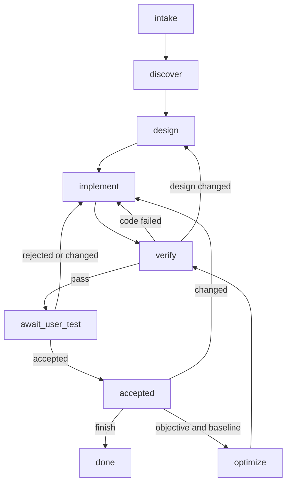

# Business feature development workflow

This workflow develops business features and keeps requirements, documentation,
code and verification linked. Research methodology and research agents are unchanged.
The driver route-delivery feature is an example request, not an implementation task here.

## Execution model

`graph.json` is the executable transition definition. `nodes.md` defines the work
contracts. `tools/feature-workflow/workflow.mjs` is a dependency-free Node.js ledger
and transition validator. It does not call models or run application commands.
The agent reads the current node, performs authorized work, records evidence and
requests a transition. A failed check leaves the run unchanged.

This is an advisory local controller, not a sandbox or authentication service.
The agent can edit local files, including the ledger. It cannot prove that tests
actually ran, documents are correct or a user really approved by checking files.
User acceptance must come from an actual user message; never fabricate it.
For enforced approvals, a future trusted host must own the ledger and acceptance
endpoint, authenticate users and mediate actions. No claim of tamper resistance is made.

## Main flow



Any active node can ask for a material user decision and enter `await_decision`;
resume returns to its saved node. Cancellation ends the run. Missing tools or
failed checks leave the node active with an explicit blocker in the evidence.
Do not repeatedly retry without new evidence; after two failures of the same
approach, diagnose and record a revised approach or request a necessary decision.

## Start and operate

Run commands from the repository root with Node.js (structuredClone support required).
Create a task folder yourself; the CLI never overwrites an existing run.

```powershell
New-Item -ItemType Directory -Force work-items/FEATURE-001
node tools/feature-workflow/workflow.mjs init work-items/FEATURE-001/run.json . FEATURE-001 GVRP_Entry_API/src GVRP_Entry_client_v2/src GVRP_Document
node tools/feature-workflow/workflow.mjs status work-items/FEATURE-001/run.json
node tools/feature-workflow/workflow.mjs step work-items/FEATURE-001/run.json ready work-items/FEATURE-001/proof.json
node tools/feature-workflow/workflow.mjs diagram
node --test tools/feature-workflow/workflow.test.mjs
```

Choose scope paths deliberately: all affected source, tests, configuration,
dependency manifests and design documentation must be included. Do not include
the run/evidence directory, generated build folders or secrets. Directory scopes
detect new and removed files. Scope omissions are a review responsibility.
Scope stays fixed for the run; a material expansion needs a new run and explicit
links to the prior run. Initial paths must exist.

Before each transition, create a proof JSON with the current revision and relative
paths to nonempty evidence files. Required names are defined in `graph.json`:

```json
{
  "revision": 0,
  "artifacts": {"request": "work-items/FEATURE-001/request.md"}
}
```

All evidence resolves within the declared repository root. The ledger records
file hashes and timestamps, not complete historical copies: retain evidence
versions in Git or immutable task artifacts if full reconstruction is needed.
Keep one writer per run. A `.lock` file prevents simultaneous CLI mutations.
After a crash, inspect the run and confirm no writer is active before removing a
stale lock. Writes use a temporary file and rename. The recorded graph hash
prevents silently applying a changed definition to an old run.

## Checkpoint and recovery

After a meaningful unit of work, before a long operation, or before yielding,
save progress using `checkpoint-input.example.json` as a template. Replace its
revision with the current run revision. Use repository-relative file paths.
Record completed/remaining work, decisions, blockers, next reading, next action
and running processes. Evidence paths point to actual check results; never put
credentials in these records. An empty evidence list claims no completed checks.

```powershell
node tools/feature-workflow/workflow.mjs checkpoint work-items/FEATURE-001/run.json work-items/FEATURE-001/checkpoint-input.json
node tools/feature-workflow/workflow.mjs recover work-items/FEATURE-001/run.json
```

Checkpoint writes are locked and atomic like transitions. They increment the
revision but preserve node, handoff and approval gates. Each checkpoint is retained
in history, including hashes of scoped files and referenced evidence. Refresh
the proof revision before a subsequent transition. Existing runs need no migration.

Recovery is read-only. It returns current state, saved progress, file additions,
deletions/modifications, stale historical evidence and warnings about changed graph
or unavailable scope. A missing top-level scope path is reported as unverifiable;
recovery does not silently narrow the scope. Old checkpoints are explicitly marked
when the run has advanced. Read current node instructions and latest transition
evidence before trusting an old next action. Recorded processes are not resumed
or restarted automatically. File hashes cannot establish semantic correctness.

In a fresh session, provide the run path and ask the agent to run `recover`, read
AGENTS.md and the current node contract, inspect reported changes, then continue
only within existing authorization. Waiting states still require actual user input.
This does not schedule a wakeup after quota reset. Checkpoints can only preserve
work saved before interruption; the filesystem may contain additional edits.
Run the controller with one workspace writer at a time for a consistent snapshot.

## User testing and optimization

On verification pass, the tool fingerprints the scoped files. Include the run ID
and `handoff` hash in the user handoff. Record actual acceptance as:

```json
{
  "decision": "accepted",
  "run_id": "FEATURE-001",
  "handoff": "COPY_THE_HANDOFF_HASH_FROM_RUN_JSON",
  "source": "Reference to the actual user message accepting this handoff"
}
```

Reference this file as `user_acceptance` in the transition proof. Acceptance,
optimization start and completion fail if scoped files differ from the handoff.
Use `changed` to return to implementation and reverify. Optimization is optional;
it requires an objective and measured baseline. After optimization, verify and
obtain user acceptance again for the new handoff. User test acceptance does not
authorize deployment or publication.

## Documentation synchronization

Use stable requirement IDs and the `traceability-template.md` table. During
discovery, inspect codebase-memory if available and verify its results against
current files; otherwise use repository search. Record the revision inspected.
Do not assume the index is fresh or that semantic similarity proves implementation.

Before code: update or create the relevant design and acceptance criteria.
After code: inspect every changed behavior against the design and requirements.
Fix code that violates accepted requirements. Update implementation descriptions
when compatible implementation details change. Ask the user when the requirement
itself must change. A running program alone never justifies rewriting requirements.
Mark proposed code/test links as planned until inspected and verified.

Diagrams are code, not decoration. Once the design is accepted, load the
`architecture-diagrams` skill without waiting to be asked and commit the design
as PlantUML (`.puml` source plus rendered SVG/PNG) alongside the markdown
documents, following that skill's patterns and folder conventions. Reverse
diagrams from actual source (via the code index and file inspection) rather
than inventing classes or flows; record what was verified against code and
what remains an assumption.

UI-facing verification uses the real browser. At the test step, load the
`browser-skill` without waiting to be asked and exercise the UI on screen with
the `bsk` CLI (observe before acting, stop the session afterwards, follow that
skill's tab-borrowing and injection-caution rules). Record the session steps
and observations as verification evidence; if `bsk` is unavailable, say so
explicitly instead of claiming screen verification.

## Adoption

For a business feature, instruct the agent to follow this README and `nodes.md`,
initialize a run, and use the CLI for every transition. This does not automatically
register a new agent or change the existing research routing. Keep scientific
validation in the existing research workflow when a business change depends on
an unverified scientific assumption; link the resulting evidence explicitly.

Status: local controller and contracts, not an autonomous agent platform.
